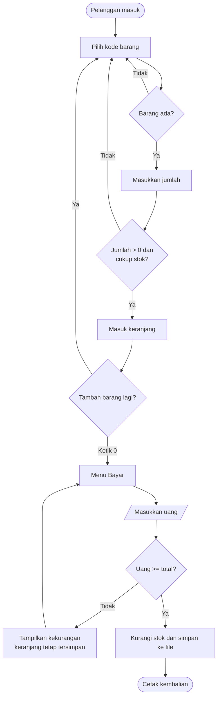

<div align="center">

```text
╔══════════════════════════════════════════╗
║                                          ║
║     S I S T E M   K A S I R   (S K S)    ║
║        Kasir konsol berbasis Pascal      ║
║                                          ║
╚══════════════════════════════════════════╝
```


**Aplikasi kasir sederhana untuk mengelola stok barang dan melayani pembelian langsung dari terminal.**

[Tentang](#-tentang) · [Peran Pengguna](#-peran-pengguna) · [Alur Belanja](#-alur-belanja) · [Konsep yang Dipakai](#-konsep-pemrograman-yang-dipakai) · [Pengamanan Input](#-pengamanan-input) · [Menjalankan](#-menjalankan-program) · [Pembuat](#-pembuat)

</div>

---

## 📌 Tentang

**Sistem Kasir Sederhana (SKS)** adalah program kasir berbasis teks yang ditulis dengan **Free Pascal**. Satu program melayani dua peran: **admin** yang mengatur daftar barang, dan **pelanggan** yang memilih barang, mengisi keranjang, lalu membayar.

Beberapa hal yang membuat program ini praktis dipakai:

- Data barang disimpan ke berkas `barang.dat`, jadi stok tidak hilang ketika program ditutup.
- Saat pertama dijalankan tanpa berkas data, program membuat tiga barang contoh secara otomatis.
- Semua input angka diperiksa. Salah ketik tidak membuat program berhenti, melainkan menampilkan menu kembali.
- Layar dibersihkan saat program mulai tanpa memakai unit `crt`, sehingga riwayat terminal masih bisa di-scroll.

---

## 👥 Peran Pengguna

Dari menu awal, pengguna memilih salah satu peran. Admin harus memasukkan password, sedangkan pelanggan bisa langsung masuk.

| Peran | Akses | Menu yang tersedia |
|:--|:--|:--|
| 🛠️ **Admin** | Password | Lihat barang · Tambah barang · Edit barang · Hapus barang · Logout |
| 🛒 **Pelanggan** | Langsung | Lihat barang · Beli barang · Lihat keranjang · Bayar · Logout |

> **Password admin untuk demo:** `admin123`

### Rincian menu admin

| Menu | Yang terjadi |
|:--|:--|
| Lihat barang | Menampilkan kode, nama, harga, dan stok semua barang |
| Tambah barang | Meminta kode, nama, harga, dan stok. Kode tidak boleh kosong atau kembar (huruf besar/kecil dianggap sama). Data ditampilkan dulu untuk dikonfirmasi |
| Edit barang | Mengubah nama, harga, dan stok. Perubahan ditampilkan dalam bentuk `lama -> baru` sebelum disimpan |
| Hapus barang | Meminta konfirmasi lebih dulu. Barang yang sedang ada di keranjang tidak bisa dihapus |

### Rincian menu pelanggan

| Menu | Yang terjadi |
|:--|:--|
| Lihat barang | Sama seperti daftar barang di admin |
| Beli barang | Memilih kode barang dan jumlah beli, bisa berulang sampai pelanggan mengetik `0` |
| Lihat keranjang | Menampilkan rincian barang, jumlah, subtotal, dan total belanja |
| Bayar | Memasukkan uang. Jika cukup, stok berkurang dan kembalian dihitung |

---

## 🧾 Alur Belanja



Dua hal yang perlu diketahui tentang keranjang:

1. Barang di keranjang **belum mengurangi stok**. Stok baru berkurang setelah pembayaran berhasil.
2. Keranjang selalu kosong setiap program dibuka kembali, karena isinya tidak disimpan ke file.

---

## 🧠 Konsep Pemrograman yang Dipakai

| Konsep | Dipakai untuk |
|:--|:--|
| `record` | `TBarang` (kode, nama, harga, stok) dan `TDataSimpan` (jumlah barang + seluruh data) |
| `array` | Daftar barang `barang[1..100]` dan jumlah per barang di keranjang `keranjangQty[1..100]` |
| `file of record` | Menyimpan dan memuat seluruh data barang ke `barang.dat` sekaligus |
| `procedure` dan `function` | Setiap fitur dipisah, misalnya `TambahBarang`, `BayarTransaksi`, dan `Konfirmasi` |
| `repeat-until` | Semua menu dan semua validasi input yang harus diulang |
| `for-to-do` | Mencari barang berdasarkan kode, menampilkan daftar, menghitung total, menggeser data saat hapus |
| `case-of` | Memilih aksi dari pilihan menu |
| `if-then-else` bertingkat | Pemeriksaan stok, saldo pembayaran, kode kembar, dan barang di keranjang |
| `Exit` | Keluar lebih awal dari prosedur ketika syarat tidak terpenuhi |
| Kompilasi bersyarat | `{$IFDEF WINDOWS}` memilih cara membersihkan layar sesuai sistem operasi |

### Menu berbasis `repeat-until` dan `case-of`

```pascal
repeat
  { tampilkan menu }
  if BacaAngka('Pilih menu: ', menu) then
  begin
    case menu of
      1: TampilBarang;
      2: BeliBarang;
      3: LihatKeranjang;
      4: BayarTransaksi;
      0: writeln('Logout user...');
    else
      writeln('Pilihan tidak valid!');
    end;
  end
  else
    menu := -1;   { bukan angka: ulangi dan tampilkan menu lagi }
until menu = 0;
```

### Simpan seluruh data dengan satu `file of record`

```pascal
data.jumlah := jumlahBarang;
for j := 1 to MaksBarang do
  data.dataBarang[j] := barang[j];

Assign(f, 'barang.dat');
Rewrite(f);
Write(f, data);
Close(f);
```

### Menghapus barang dengan menggeser array

```pascal
for j := idx to jumlahBarang - 1 do
begin
  barang[j] := barang[j + 1];
  keranjangQty[j] := keranjangQty[j + 1];
end;
jumlahBarang := jumlahBarang - 1;
```

---

## 🛡️ Pengamanan Input

Program dibuat supaya tidak mudah rusak oleh input yang salah.

| Situasi | Perilaku program |
|:--|:--|
| Mengetik huruf, simbol, atau kosong di menu | Menampilkan pesan salah, lalu **menu ditampilkan kembali** |
| Mengetik huruf atau angka negatif di harga, stok, jumlah beli, atau uang | Ditolak, pertanyaan diulang sampai valid |
| Kode atau nama barang dikosongkan | Proses dibatalkan dengan pesan |
| Kode barang sudah dipakai | Ditolak, tanpa membedakan huruf besar dan kecil |
| Jumlah beli melebihi sisa stok | Ditolak, memperhitungkan barang yang sudah ada di keranjang |
| Stok diedit lebih kecil dari jumlah di keranjang | Ditolak |
| Menghapus barang yang ada di keranjang | Ditolak sampai transaksi selesai |
| Uang pembayaran kurang | Menampilkan kekurangan, keranjang tidak hilang |
| `barang.dat` berisi jumlah yang tidak masuk akal | Program berhenti dengan pesan, tidak memakai data rusak |

Pemeriksaan angka dilakukan oleh fungsi `HanyaAngka`, yang hanya menerima karakter `0`–`9` (dan satu titik pada harga):

```pascal
function HanyaAngka(s: string; bolehDesimal: boolean): boolean;
```

Karena tanda minus tidak termasuk karakter yang diterima, nilai negatif otomatis tertolak.

---

## 🚀 Menjalankan Program

**Kebutuhan:** [Free Pascal Compiler](https://www.freepascal.org/) (atau Lazarus).

```bash
# kompilasi
fpc tes.pas

# jalankan
tes.exe          # Windows
./tes            # Linux / macOS
```

> Ganti `tes.pas` dengan nama berkas sumber yang kamu pakai.

Jalankan dari terminal langsung (CMD, PowerShell, atau terminal Linux). Jendela konsol bawaan sebagian IDE kadang membatasi scroll dan perintah pembersih layar.

### Data awal

Jika `barang.dat` belum ada, program membuat tiga barang berikut:

| Kode | Nama | Harga | Stok |
|:--|:--|--:|--:|
| B001 | Mouse | Rp 75.000 | 10 |
| B002 | Keyboard | Rp 150.000 | 5 |
| B003 | Headset | Rp 100.000 | 8 |

Untuk mengembalikan ke data awal, tutup program lalu hapus `barang.dat`.

### Contoh alur uji cepat

1. Pilih **2. Login User** → **2. Beli barang** → masukkan `B001`, jumlah `2` → ketik `0` untuk selesai.
2. Pilih **3. Lihat keranjang**. Totalnya Rp 150.000.
3. Pilih **4. Bayar** → masukkan `200000`. Kembalian Rp 50.000, stok Mouse tersisa 8.
4. Logout, lalu **1. Login Admin** dengan password `admin123` untuk menambah, mengedit, atau menghapus barang.

---

## ✍️ Pembuat

| Nama | NIM | Kelas |
|:--|:--|:--|
| _isi nama_ | _isi NIM_ | _isi kelas_ |

_Mata kuliah / instansi: isi sesuai kebutuhan._
